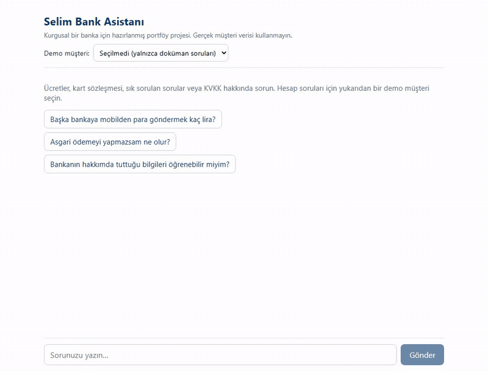
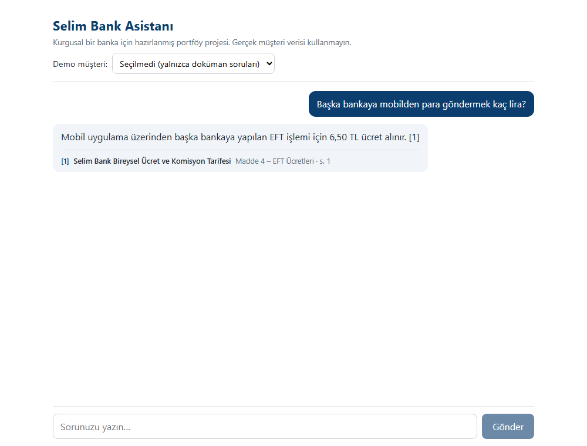
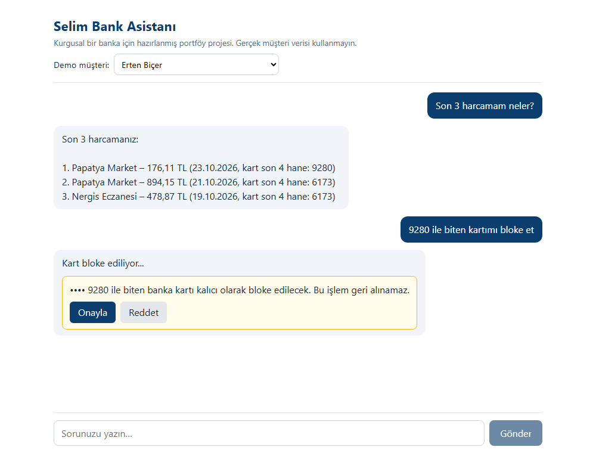
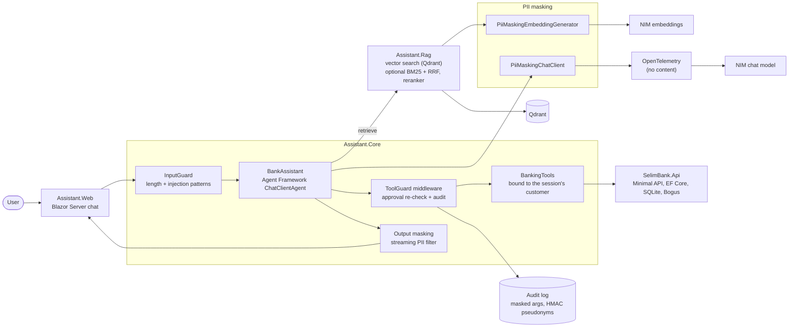

# Selim Bank Assistant

[](https://github.com/egeselim/turkish-banking-rag/actions/workflows/ci.yml)

> **Türkçe özet:** Kurgusal "Selim Bank" için Türkçe konuşan bir bankacılık asistanı. Ücret tarifesi, kredi kartı sözleşmesi, SSS ve KVKK hakkındaki soruları kaynak göstererek cevaplar (RAG). Seçilen demo müşterinin bakiyesini ve işlemlerini araçlarla sorgular. Kart bloke etmek gibi geri alınamaz işlemleri yalnızca kullanıcı arayüzde onaylarsa yapar. Modele, embedding'e, loglara ve telemetriye giden her metindeki kişisel veri (TCKN, kart, IBAN, telefon, e-posta) önce maskelenir. .NET 10, Microsoft Agent Framework ve NVIDIA NIM ile yazılmış bir portföy projesidir. Banka, belgeler ve müşteri verileri tamamen kurgusaldır. Ayrıntılı plan ve kararlar `docs/` altında, Türkçe.

A Turkish-speaking banking assistant for a fictional bank: retrieval-augmented answers with citations, a tool-calling agent for account questions, human approval for irreversible actions, and PII masking on everything that leaves the process. Built with .NET 10, Microsoft Agent Framework and NVIDIA NIM as a portfolio project; **the bank, its documents and all customer data are fictional**.



## What it does

- **Answers from documents, with citations.** Questions about the fee tariff, the credit card agreement, the FAQ and Türkiye's data protection law (KVKK, the official text) are answered only from retrieved passages, each cited as `[n]` with a source card. If the documents do not cover a question, the assistant says so instead of guessing.
- **Account questions through tools.** After choosing a demo customer, users can ask for their balance, recent transactions ("son 3 harcamam") and follow-ups ("ikincisine itiraz et"). The customer id comes from the server-side session, never from the model.
- **Human approval for irreversible actions.** Blocking a card or opening a complaint stops at an approval card whose text is built from the call's real arguments, not from model output. Nothing runs until the user clicks *Onayla*.
- **PII never reaches the model, logs or traces.** Turkish ID numbers (checksum-validated), Luhn-valid card numbers, IBANs (mod-97), mobile numbers and e-mails are masked before any text goes to the LLM, the embedding model, the reranker, logs or OpenTelemetry.
- **Measured, not assumed.** A 100-question eval set, an offline retrieval eval gated in CI, an LLM-judged answer eval and a 30-case prompt-injection suite.

| Cited answer | Approval card |
|---|---|
|  |  |

## Architecture



The masking decorators live in `Assistant.Core.Safety` and use the detectors of `Assistant.Privacy`; the reranker has the same wrapper. `SelimBank.AppHost` (.NET Aspire) starts Qdrant, the bank API and the web app.

| Project | Role |
|---|---|
| `src/SelimBank.AppHost` | .NET Aspire host: starts Qdrant, the bank API and the web app, passes secrets as parameters |
| `src/Assistant.Web` | Blazor Server chat with streaming answers, source cards and approval cards |
| `src/Assistant.Core` | Agent, tools, middleware (approval check, audit, output masking), NIM wiring, retrieval composition |
| `src/Assistant.Rag` | PDF reading (PdfPig), structure-aware chunking, Turkish text normalisation, BM25, RRF, reranking |
| `src/Assistant.Privacy` | PII detection and masking (regex candidates confirmed by TCKN, Luhn and IBAN checksums) |
| `src/SelimBank.Api` | Fake bank backend; every query is scoped to the caller's customer id; seeded with Bogus (tr) |
| `eval/Eval.Runner` | Retrieval and answer evaluation, reports and the CI regression gate |

## Evaluation

All numbers are from `eval/questions.jsonl` (92 answerable questions over four documents, 8 that the documents do not answer). Full reports: [`docs/eval/baseline.md`](docs/eval/baseline.md) and [`eval/reports/`](eval/reports/).

**Retrieval** (offline: embeddings and rerank scores come from a committed cache, so the run needs no API key and is deterministic):

| Method | Hit@1 | Hit@5 | MRR | p95 latency |
|---|---|---|---|---|
| **Vector only (used by the app)** | **88/92** | **92/92** | **0.975** | ~7 ms |
| Hybrid (vector + Turkish BM25, RRF) | 79/92 | 90/92 | 0.910 | ~6 ms |
| Vector + reranker (nemotron-3.5-rerank-8b) | 91/92 | 92/92 | 0.995 | ~620 ms |
| Vector + reranker (llama-nemotron-rerank-vl-1b-v2) | 87/92 | 92/92 | 0.967 | ~340 ms |

The reranker improves MRR by 0.0199, just under the 0.02 threshold that was written down *before* the measurement ([ADR-003](docs/decisions/ADR-003-reranker.md)), so the simpler and faster vector-only search was kept.

**Answers** (LLM judge, 1–5; deterministic checks without a judge):

| Metric | Value |
|---|---|
| Groundedness / Completeness / Relevance | 4.67 / 4.12 / 4.22 |
| Citations that point to an accepted source | 98% |
| Answerable questions wrongly refused | 5% |
| Answer time p50 / p95 | 1.1 s / 5.1 s |

**Prompt injection** (30 cases: direct, multi-turn, obfuscated, and indirect through tool results and poisoned documents): the hard checks (no write without approval, only the session's customer, no other customer's data, no raw PII) held in **30/30**; the model was talked into proposing a forbidden approval once (29/30), which the approval card still stopped.

> These baselines were taken with a temporary model setup: the planned main model (`nemotron-3-ultra`) returned empty answers on NVIDIA's free tier at the time, so the backup `nemotron-3.5-lightning` (thinking disabled) answers and `nemotron-3.5-bolt` judges ([ADR-001](docs/decisions/ADR-001-nim-model-selection.md)). Judge scores are comparable only between runs with the same judge.

## Why it is built this way

- **Masking sits directly above the raw model client.** Agent Framework adds tool results to the conversation inside its function-invocation loop; a masking layer outside that loop would let tool output reach the model unmasked. The same holds for embeddings and the reranker. Only the wrapped clients are registered in DI, and a test fails if a raw one is resolvable.
- **Approval is enforced in code, twice, not in the prompt.** `ApprovalRequiredAIFunction` stops irreversible tools until the user approves; a function middleware (`ToolGuard`) checks again that the call matches an approval surfaced in this session, with the same arguments, used once. Tests count write requests to the bank: 0 before approval, 0 after rejection, exactly 1 after approval.
- **The customer id is never a tool parameter.** Tools are created per turn, bound to the session's customer; the bank API scopes every query to the `X-Customer-Id` header and answers 404 for anything else. A model that is persuaded to "show customer 2" has no way to ask for it.
- **Own hybrid search, then measured away.** The Qdrant connector's hybrid search uses an unranked keyword filter, so a Turkish BM25 with stemming and RRF fusion was written ([ADR-002](docs/decisions/ADR-002-hybrid-search.md)). The 100-question eval later showed that with a strong embedding model BM25 pulls correct results down, so the app now searches vectors only; the code stays switchable (`Rag:Mode`).
- **Deterministic evaluation in CI.** Embeddings and rerank scores are cached on disk (keys are hashes of the masked text; no text is stored), so the retrieval eval runs without a key and fails the build if the app's search method drops below the baseline. This caught a real portability bug: PdfPig takes widths of non-embedded fonts from the operating system, so a heading was classified differently on Linux; the reader now relies only on positions written in the PDF.
- **Every decision has a record.** [`docs/decisions/`](docs/decisions/) holds the model choice, the search design and the reranker decision with their measurements; [`docs/PROGRESS.md`](docs/PROGRESS.md) is the step-by-step log, including what went wrong.

## Security

- **PII masking** (`Assistant.Privacy`): typed placeholders (`[TCKN]`, `[KART_NO]`, `[IBAN]`, `[TELEFON]`, `[EPOSTA]`); numbers that fail their checksum are left alone, so amounts and dates are not masked. The answer stream is masked too, including the case where a card number is split across streamed chunks.
- **Telemetry**: sensitive-data capture is turned off explicitly (an environment variable could otherwise turn it on). Exporter-side processors mask span tags and log records, and drop spans whose events carry PII. A leak test runs a full conversation with canary PII through the real composition and searches every request, log line, span and metric for it.
- **Audit log**: every tool call is written with masked arguments, a keyed HMAC pseudonym instead of the customer id, the outcome and the duration; tool results are not stored.
- **Input guard**: a short list of injection phrases (Turkish and English, normalised against Turkish letters and invisible characters) stops obvious attacks before retrieval; it is a cheap filter, the structural controls above are the real protection.
- **Known risks** (see [`docs/PLAN.md`](docs/PLAN.md), section 6): the model sometimes relays an instruction planted in a document as advice, and occasionally invents contact details after saying it found nothing; the UI renders answers as plain text, so a markdown image planted by an injection cannot exfiltrate data, and external image URLs must be blocked if markdown rendering is ever added.

## Running it

**Prerequisites:** .NET SDK 10.0.402 or later, Docker (for Qdrant and the integration tests), and an [NVIDIA NIM](https://build.nvidia.com) API key for the chat, embedding and reranking models (free tier).

1. Store the NIM key in the AppHost's user-secrets (it never goes into a file in the repository):

   ```bash
   dotnet user-secrets set "Nim:ApiKey" "<your NIM API key>" --project src/SelimBank.AppHost
   ```

2. Optionally set the audit pseudonym key (see [below](#audit-pseudonym-key)).

3. Start everything:

   ```bash
   dotnet run --project src/SelimBank.AppHost
   ```

   The Aspire dashboard link is printed in the console. The chat runs at https://localhost:7221 (http://localhost:7185); the first start indexes the PDFs, which takes about a minute.

Model ids live in [`src/Assistant.Web/appsettings.json`](src/Assistant.Web/appsettings.json) (`Nim:*`), the search method in `Rag:Mode` / `Rag:RerankModel`.

**Tests and evaluation**

```bash
dotnet build
dotnet test --filter-not-trait "Category=Live"            # no API key; needs Docker for the Qdrant integration tests
dotnet run --project eval/Eval.Runner -- --subset smoke --offline                # retrieval, no key
dotnet run --project eval/Eval.Runner -- --mode answer --judge small --limit 3   # answers, calls NIM
```

Tests marked `Live` call the real NIM API and are skipped without a key.

**Troubleshooting:** if the dashboard shows `selimbank-api` as *Unhealthy* and `web` stuck in *Waiting*, Windows may have reserved the ports (Hyper-V/WinNAT reserve ranges that change between reboots). Check with `netsh int ipv4 show excludedportrange protocol=tcp`; the launch ports are in `src/*/Properties/launchSettings.json`.

## Audit pseudonym key

The audit log stores a pseudonym derived with a secret key (HMAC-SHA256) instead of the customer number. Put the key in the AppHost's user-secrets; the AppHost passes it to the web app.

1. Generate a random key and store it. The commands do not print it.

   PowerShell:

   ```powershell
   $bytes = New-Object byte[] 32
   [Security.Cryptography.RandomNumberGenerator]::Create().GetBytes($bytes)
   dotnet user-secrets set "Audit:PseudonymKey" ([Convert]::ToBase64String($bytes)) --project src/SelimBank.AppHost
   ```

   Git Bash:

   ```bash
   dotnet user-secrets set "Audit:PseudonymKey" "$(openssl rand -base64 32)" --project src/SelimBank.AppHost
   ```

2. Restart the AppHost.

**Without a key** the app still runs: it generates a random key on every start and logs a warning. That is fine for development, but pseudonyms then change on every restart, and changing the key later breaks the link between old and new rows. Never put the key in code, `appsettings.json` or logs.

## Where the audit log lives

Rows go to the `AuditEntries` table in `src/Assistant.Web/audit.db` (ignored by git); change it with `Audit:ConnectionString`. Tool arguments are stored masked; tool results and the text of blocked messages are not stored.

## Repository map

`docs/PLAN.md` (plan and risks) · `docs/PROGRESS.md` (log) · `docs/decisions/` (ADRs) · `docs/eval/baseline.md` (evaluation) · `docs/sources/` (the four source PDFs and how the fictional ones are generated) · `eval/` (question and injection sets, runner, caches, reports) · `.github/workflows/ci.yml` (CI)

## License and data

Code and fictional documents are released under the [MIT License](LICENSE); the bundled DejaVu fonts keep their own license (`tools/SourceDocs.Generator/Fonts/DejaVu-LICENSE.txt`). The KVKK text (Law No. 6698) is an official legal text from mevzuat.gov.tr and may be reproduced freely (FSEK art. 31). No real bank, logo or customer data is used; all customer data is generated with Bogus and checksum algorithms.
